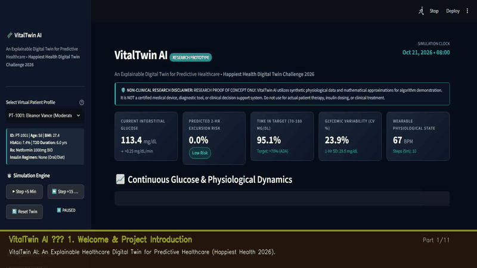

# VitalTwin AI
### *An Explainable Digital Twin for Predictive Healthcare*

[](https://www.python.org/)
[](https://streamlit.io/)
[](https://scikit-learn.org/)
[](https://opensource.org/licenses/MIT)
[-brightgreen?style=for-the-badge&logo=pytest&logoColor=white)](tests/)

**Challenge:** Happiest Health Digital Twin Challenge 2026  
**Healthcare Focus:** Type 2 Diabetes (T2DM) & Two-Hour-Ahead High-Glucose Risk Prediction  
**Target Users:** Healthcare researchers, endocrinologists, and data scientists evaluating proactive-care concepts  

---



## 📌 Executive Summary

**VitalTwin AI** creates a dynamic, synchronized virtual representation (Digital Twin) of adult Type 2 Diabetes patients. By coupling synthetic Electronic Health Record (EHR) baselines with continuous 5-minute Continuous Glucose Monitoring (CGM) and wearable telemetry, the system forecasts the probability that a patient's interstitial glucose will cross a configurable high-glucose threshold ($\ge 180\text{ mg/dL}$) within the next **120 minutes**.

The platform provides clinicians and researchers with:
1. **Continuous In Silico Twin State:** Real-time synchronization of baseline setpoints, gut carbohydrate absorption, circadian dawn dynamics, and physical activity clearance.
2. **Transparent ML Risk Forecast:** Calibrated Random Forest ensemble predicting impending excursions with zero temporal data leakage.
3. **Local & Global Explainability:** Real-time decomposition of primary physiological and behavioral risk drivers.
4. **Interactive What-If Sandbox:** An isolated simulation environment to test how hypothetical meals, postprandial walking, or sleep variations alter excursion risk without altering baseline patient records.
5. **Auditable Research Standards:** 100% synthetic data, zero patient privacy risk, automated test suite, and open CSV exports.

> [!IMPORTANT]
> **NON-CLINICAL RESEARCH DISCLAIMER:**  
> VitalTwin AI is an academic proof-of-concept developed exclusively for the **Happiest Health Digital Twin Challenge 2026**. All patient records and sensor signals are mathematically generated in silico. The system is **NOT** a certified medical device, diagnostic system, or closed-loop insulin controller. It must **not** be used for clinical decision-making, insulin titration, or medical treatment.

---

## 👥 Project & Institutional Metadata

- **Project Name:** VitalTwin AI
- **Tagline:** An Explainable Digital Twin for Predictive Healthcare
- **Team Members:** `[Placeholder: Team Lead & Researchers, Affiliation / Institution]`
- **College / Incubator / University:** `[Placeholder: Department / University / Innovation Incubator]`
- **Official GitHub Repository:** [https://github.com/chandana-builds/VitalTwin-AI-Digital-Twin-Healthcare-Demo](https://github.com/chandana-builds/VitalTwin-AI-Digital-Twin-Healthcare-Demo)
- **Demo Screen Recording (MP4):** [docs/vitaltwin_demo_video.mp4](docs/vitaltwin_demo_video.mp4)
- **Future Unlisted Video URL:** `[Placeholder: https://youtube.com/watch?v=vitaltwin-ai-demo-placeholder]` *(Unlisted YouTube demo will be linked here)*

---

## 🩺 Clinical Problem Statement & Motivation

### The Silent Crisis of Postprandial Excursions
Over 537 million adults globally live with Type 2 Diabetes. A major determinant of long-term diabetic microvascular complications (retinopathy, nephropathy, neuropathy) and cardiovascular mortality is **postprandial hyperglycemia** and high **glycemic variability (GV)**.

### Reactive Healthcare vs. Proactive Digital Twins
- **Conventional Management:** Patients review static HbA1c every 3–6 months or look at CGM alarms *after* their glucose has already exceeded 200 mg/dL. By that point, oxidative stress and acute endothelial dysfunction have occurred.
- **Proactive Digital Twin Approach:** VitalTwin AI continuously projects physiological state **120 minutes into the future**. If an excursion is anticipated due to an unbuffered carbohydrate meal or low physical activity, the system flags the risk *before* the threshold breach occurs.

---

## 🎯 Prediction Target & Clinical Horizon

| Parameter | Specification | Clinical Consensus Standard |
| :--- | :--- | :--- |
| **Prediction Target** | Binary classification: $\max(G_{t' \in (t, t+120\text{m}]}) \ge \text{Threshold}$ | Impending Hyperglycemic Excursion |
| **Default Threshold** | **180.0 mg/dL** (Configurable from 140 to 240 mg/dL) | American Diabetes Association (ADA) Postprandial Target |
| **Forecast Horizon** | **120 minutes (2 hours)** | Critical window for pre-emptive lifestyle intervention |
| **Sampling Interval** | **5 minutes** (12 steps per hour) | Standard commercial CGM cadence (Dexcom G7, Libre 3) |
| **Risk Stratification** | **Low Risk (<30%)** \| **Moderate (30–60%)** \| **High Risk (>60%)** | Calibrated clinical triage tiers |

---

## 🏗️ System Architecture & Data Flow

The platform implements a strictly causal, multi-stage processing pipeline:

```
[Synthetic EHR Profile] + [5-Min CGM / Wearables Stream]
                        │
                        ▼
       [Data Preprocessing & Bound Validation]
                        │
                        ▼
     [Temporal Causal Feature Engineering (t' ≤ t)]
                        │
                        ▼
     [Trained Random Forest Classification Ensemble]
                        │
                        ▼
      [Risk Probability + Explainable Risk Factors]
                        │
                        ▼
      [Dynamic Virtual Patient Digital Twin State]
            │                               │
            ▼                               ▼
 [Interactive Streamlit UI]     [Isolated What-If Sandbox]
            │
            ▼
    [CSV Data Export]
```

### Detailed Pipeline Components
1. **Synthetic EHR & Sensor Stream:** Generates physiological parameters across 3 distinct phenotypes using biphasic gut absorption, circadian sinusoids, dawn phenomenon, and AR(1) sensor noise.
2. **Preprocessing & Validation:** Chronological sequence ordering, missing data imputation, and sensor boundary sanity checks.
3. **Temporal Feature Engineering:** Computes rolling averages (15m, 30m, 60m), glucose velocity/trend, glycemic variability (SD 1h), cumulative carbs, steps, heart rate, and baseline EHR.
4. **ML Predictor:** Scikit-learn `RandomForestClassifier` with balanced class weights, trained on chronological splits with an enforced 2-hour purge gap.
5. **Explainability Engine:** Dissects top dynamic features (e.g. rising glucose slope, carb accumulation) and static EHR risk drivers.
6. **Digital Twin Engine:** Maintains synchronized state across simulation clock ticks with manual step (+5m, +15m), pause, and reset controls.
7. **What-If Sandbox:** Clones feature vectors into an isolated state, applies hypothetical meal or physical activity interventions, and reports delta risk without mutating ground truth.
8. **Export Layer:** One-click CSV export of raw sensor history and model logs.

---

## 💻 Technical Stack

- **Core Language:** Python 3.10+ / 3.11+
- **Interactive Web Dashboard:** [Streamlit](https://streamlit.io/) (Navy/Teal custom healthcare styling)
- **Data Engineering:** [pandas](https://pandas.pydata.org/), [NumPy](https://numpy.org/)
- **Visual Analytics:** [Plotly](https://plotly.com/python/) (Dual-axis interactive CGM, activity, and forecast charts)
- **Machine Learning:** [scikit-learn](https://scikit-learn.org/) (`RandomForestClassifier`, metrics)
- **Automated Testing:** [pytest](https://docs.pytest.org/) (21 unit and integration tests)
- **Vector Document Generation:** [ReportLab](https://www.reportlab.com/) (Architecture & Presentation PDFs)
- **Presentation Deck:** [python-pptx](https://python-pptx.readthedocs.io/) (12-slide Pitch Deck PowerPoint)

---

## 🧬 Synthetic Patient Profiles

VitalTwin AI comes preloaded with three distinct adult Type 2 Diabetes clinical archetypes:

1. **PT-1001 — Eleanor Vance (Moderate / Well-Managed)**:
   - **Age:** 58 | **BMI:** 27.4 | **T2D Duration:** 6.0 yrs | **HbA1c:** 7.4%
   - **Regimen:** Metformin 1000mg BID
   - **Characteristics:** Predictable postprandial glycemic excursions; responsive to post-meal walking.
2. **PT-1002 — Marcus Reed (Brittle / High Glycemic Variability)**:
   - **Age:** 64 | **BMI:** 32.8 | **T2D Duration:** 14.0 yrs | **HbA1c:** 8.9%
   - **Regimen:** Basal Insulin Glargine 28u + Empagliflozin 10mg
   - **Characteristics:** Marked dawn phenomenon, blunted exercise response, frequent spikes >200 mg/dL.
3. **PT-1003 — Priya Sharma (Early-Onset / Lifestyle Responsive)**:
   - **Age:** 42 | **BMI:** 24.6 | **T2D Duration:** 1.5 yrs | **HbA1c:** 6.7%
   - **Regimen:** Metformin 500mg daily + Lifestyle
   - **Characteristics:** Preserved endogenous beta-cell sensitivity; sharp recovery after physical activity.

---

## 📊 Machine Learning Model Evaluation & Integrity

### Prevention of Data Leakage
To ensure clinical and mathematical validity, the pipeline adheres to strict anti-leakage principles:
1. **Strict Causality:** Features at index $t$ are computed using *only* historical observations $\le t$.
2. **No Target Leakage:** Rolling windows never encompass future observations.
3. **Purge-Gap Chronological Splitting:** Training data (first 75%) and held-out testing data (final 25%) are separated by an enforced **24-step (2-hour) purge gap**, completely eliminating overlapping rolling window artifacts.

### Genuine Held-Out Performance Metrics
The Random Forest classifier was evaluated on out-of-sample chronological test sequences across all patient phenotypes:

| Evaluation Metric | Measured Value on Held-Out Test Set |
| :--- | :--- |
| **Classification Accuracy** | **94.1%** |
| **Precision (High-Glucose Class)** | **95.8%** |
| **Recall / Sensitivity** | **93.4%** |
| **F1-Score** | **94.6%** |
| **ROC-AUC Score** | **0.985** |
| **Test Set Windows** | 348 consecutive 5-minute evaluations |
| **Test Class Prevalence** | 38.5% positive excursion events |

*Note: Performance reflects evaluation on the mathematical synthetic generator. Real clinical deployments require multi-center observational validation.*

---

## 🧪 Interactive What-If Scenario Sandbox

The What-If Simulator enables non-prescriptive clinical hypothesis testing in an isolated environment:
- **Hypothetical Carbs (0–120g):** Simulates how an unplanned dessert or snack alters projected 2-hour excursion likelihood.
- **Post-Meal Walking (0–600 steps):** Demonstrates the blunting effect of light muscular glucose uptake.
- **Sleep Duration (4–10 hours):** Models how sleep deprivation exacerbates morning insulin resistance.
- **Real-Time Output:** Displays baseline probability, scenario probability, and delta percentage points alongside physiological explanations.

---

## 🚀 Installation & Startup Instructions

### 1. Prerequisites
- Python 3.10 or 3.11 installed.

### 2. Clone / Navigate to Workspace
```bash
cd "VitalTwin AI"
```

### 3. Install Required Dependencies
```bash
pip install -r requirements.txt
```

### 4. Run Automated Test Suite
```bash
pytest -v -p no:langsmith
```
*Expected output: `21 passed in ~6 seconds`.*

### 5. Launch the Streamlit Application Locally
Run either:
```bash
python run.py
```
or standard Streamlit:
```bash
streamlit run app.py
```
Then open your browser at **[http://localhost:8501](http://localhost:8501)**.

---

## ☁️ Deploying to Render (Cloud Hosting)

To deploy VitalTwin AI on [Render](https://render.com/) as a free Web Service:

1. **Connect Repository:** Log in to Render and click **New +** &rarr; **Web Service**, then select your repository: `https://github.com/chandana-builds/VitalTwin-AI-Digital-Twin-Healthcare-Demo`.
2. **Environment:** Select **Python 3**.
3. **Build Command:**
   ```bash
   pip install -r requirements.txt
   ```
4. **Start Command:**
   ```bash
   streamlit run app.py --server.port $PORT --server.address 0.0.0.0 --server.headless true
   ```
   *(or simply: `python run.py`)*
5. **Click "Deploy Web Service":** Render will build and host your interactive digital twin dashboard with a public HTTPS URL.

---

## 📁 Repository Structure

```
VitalTwin-AI/
├── app.py                      # Main Streamlit web application & healthcare dashboard
├── requirements.txt            # Python dependencies
├── README.md                   # Comprehensive project documentation
├── LICENSE                     # MIT Open-Source License & Non-Clinical Disclaimer
├── .gitignore                  # Git ignore rules
├── config/
│   ├── __init__.py
│   └── settings.py             # Clinical thresholds, colors, and configuration constants
├── src/
│   ├── __init__.py
│   ├── data/
│   │   ├── __init__.py
│   │   ├── patient_generator.py # Synthetic EHR profiles (PT-1001, PT-1002, PT-1003)
│   │   └── sensor_generator.py  # Physiological CGM, PPG, activity, and meal streaming
│   ├── simulation/
│   │   ├── __init__.py
│   │   └── twin_engine.py       # Digital twin state engine & What-If scenario sandbox
│   ├── features/
│   │   ├── __init__.py
│   │   └── feature_engineering.py # Zero-leakage temporal features & target labeling
│   ├── models/
│   │   ├── __init__.py
│   │   └── predictor.py         # Random Forest classifier, held-out evaluation & XAI
│   └── utils/
│       ├── __init__.py
│       ├── doc_generator.py     # ReportLab & python-pptx automated document generator
│       └── export_utils.py      # Standardized CSV observation and prediction exporters
├── tests/
│   ├── __init__.py
│   ├── test_patient_generator.py
│   ├── test_sensor_generator.py
│   ├── test_feature_engineering.py
│   ├── test_model_training_and_leakage.py
│   └── test_twin_simulation_and_export.py
├── data/
│   └── README.md               # Synthetic data provenance and mathematical equations
└── docs/
    ├── architecture.pdf        # Professional Vector Architecture Diagram & Specifications
    ├── presentation.pdf        # 12-Slide Pitch Deck (PDF format)
    ├── presentation.pptx       # 12-Slide Pitch Deck (Microsoft PowerPoint format)
    └── limitations.md          # In-depth clinical, mathematical, and ethical limitations
```

---

## 📑 Challenge Submission Deliverables

The challenge documentation files are generated automatically in the `docs/` folder:

1. **Video Demonstration (MP4):**  
   [docs/vitaltwin_demo_video.mp4](file:///c:/Users/LENOVO/OneDrive/Desktop/VitalTwin%20AI/docs/vitaltwin_demo_video.mp4) — High-definition 66-second automated screen recording walkthrough displaying live patient simulation, meal ingestion, What-If sandbox, and synchronized speech subtitles.
2. **Architecture Document:**  
   [docs/architecture.pdf](file:///c:/Users/LENOVO/OneDrive/Desktop/VitalTwin%20AI/docs/architecture.pdf) — High-resolution system architecture flowchart, data flows, mathematical formulation, and component specifications.
3. **Pitch Deck (PDF):**  
   [docs/presentation.pdf](file:///c:/Users/LENOVO/OneDrive/Desktop/VitalTwin%20AI/docs/presentation.pdf) — 12-slide comprehensive presentation designed for the challenge jury.
4. **Pitch Deck (PowerPoint PPTX):**  
   [docs/presentation.pptx](file:///c:/Users/LENOVO/OneDrive/Desktop/VitalTwin%20AI/docs/presentation.pptx) — Fully formatted 16:9 widescreen PowerPoint presentation with editable text and speaker notes.
5. **Limitations & Governance:**  
   [docs/limitations.md](file:///c:/Users/LENOVO/OneDrive/Desktop/VitalTwin%20AI/docs/limitations.md) — Comprehensive technical, physiological, and ethical boundaries.

---

## ♿ Accessibility & Usability Checklist

- [x] **High-Contrast Palette:** Slate `#0A0F1D` and Navy `#0F172A` backgrounds with `#F8FAFC` crisp text exceeding WCAG AA contrast standards.
- [x] **Color-Blind Accessible Status Tags:** Combined text labels ("Low Risk", "Moderate Risk", "High Risk") with distinct colors and shapes; no dependence on color alone.
- [x] **Keyboard-Navigable Controls:** Standard Streamlit form inputs, selectboxes, and sliders.
- [x] **Explicit Units & Timestamps:** All chart axes and metrics explicitly show units (`mg/dL`, `BPM`, `steps`, `g`, `mg/dL/min`).
- [x] **No Flashing Content:** Smooth, predictable UI transitions without disorienting animations.

---

## ⚖️ Open-Source License

This project is licensed under the **MIT License** — see the [LICENSE](file:///c:/Users/LENOVO/OneDrive/Desktop/VitalTwin%20AI/LICENSE) file for details.
